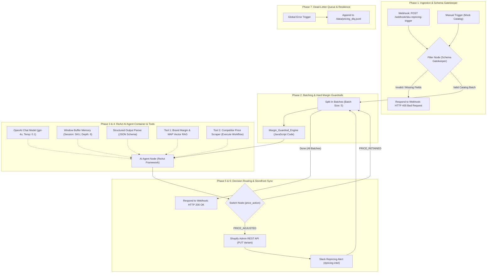

# Technical Requirement Specification (BRD / PRD / SRS)
## Project 05: E-Commerce Competitor Price Intelligence & Dynamic Re-Pricing Agent
### Project Code: `AI-AGENT-PRJ-05` | Course: AI Agent Hands-On Assessment (n8n Level 1, Level 2, API Integration & AI Agents)
**Lead Evaluator:** Deepesh Jain | **Passing Score:** ≥75.0 / 100.0 | **Target:** 100.0 / 100.0 (High Distinction)

---

## 1. Document Control & Executive Charter

| Field | Value |
| :--- | :--- |
| **Document Title** | Project 05: E-Commerce Competitor Price Intelligence & Dynamic Re-Pricing Agent Assessment |
| **Course** | AI Agent Hands-On Assessment (n8n Level 1, Level 2, API Integration & AI Agents) |
| **Project Code** | `AI-AGENT-PRJ-05` |
| **Industry Domain** | Retail E-Commerce, Pricing Optimization, Shopify REST APIs & Margin Governance |
| **Lead Evaluator** | Deepesh Jain (Lead Evaluator / Enterprise Automation Lead) |
| **Allocated Practical Time** | 2.5 Hours (Time-Boxed Practical Build & Verification) |
| **Passing Score Threshold** | Minimum 75.0 / 100.0 Points (100% compliance on Zero-Tolerance Gates required) |
| **Core Tech Stack** | n8n (v1.60+), OpenAI (gpt-4o) / Anthropic (claude-3-5-sonnet), Shopify Admin REST API, E-Commerce Margin Vector RAG, Split-in-Batches Loops, Slack Pricing Alerts |

---

## 2. Business Problem & Automation Mission

### 2.1 The Business Problem
E-commerce merchants operating in multi-channel marketplaces face severe competitive margin pressure:
1. **Predatory Undercutting:** Competing retailers deploy algorithmic scraper bots that shave \$0.50 off top-selling SKUs within minutes of market fluctuations, draining sales volume.
2. **Margin Cannibalization:** Naive repricing scripts that automatically match the lowest market price trigger "race-to-the-bottom" price wars, selling goods below the cost of goods sold (COGS).
3. **High-Volume Catalog Scale:** Catalog managers cannot manually evaluate thousands of SKUs daily across multiple competitor websites.
4. **Storefront API Synchronization:** Adjusting prices in store catalogs (Shopify, BigCommerce, Magento) requires handling API rate limits (HTTP 429) and transactional locking.

### 2.2 The Automation Mission
Candidates must engineer an autonomous **E-Commerce Competitor Price Intelligence & Dynamic Re-Pricing Agent** in n8n that synthesizes all four enterprise automation pillars:
* **n8n Level 1 Foundations:** Scheduled Cron / Webhook ingestion (`POST /webhook/sku-repricing-trigger`), schema validation filter, repricing action switch routing (`PRICE_ADJUSTED` vs `PRICE_RETAINED`), and executive summary dispatch.
* **n8n Level 2 Architecture:** Custom JavaScript Code node for Minimum Advertised Price (MAP) & COGS margin floor enforcement, chunked batch processing (`Split In Batches` loop node), sub-workflow competitor price scraping (`Execute Workflow`), and an asynchronous `Error Trigger` dead-letter queue.
* **API Integration:** RESTful communication with the Shopify Admin REST API (`PUT /admin/api/2026-01/variants/:id.json`), Bearer token authentication via environment variables (`$env.SHOPIFY_ADMIN_TOKEN`), and automatic exponential backoff retry on HTTP 429.
* **AI Agent Hands-On:** An autonomous n8n AI Agent container node running the ReAct (Reasoning + Acting) loop, bound to a low-temperature Foundation Model (`gpt-4o` or `claude-3-5-sonnet`), a Window Buffer Memory sub-node, a Vector Store RAG tool embedding Brand Margin Rules & MAP agreements, a Competitor Intelligence sub-workflow tool, and a strict JSON Output Parser.

---

## 3. High-Level Architecture & Workflow Topology



---

## 4. Software Requirements Specification (SRS)

### 4.1 Inbound Catalog Payload Schema
```json
{
  "catalog": [
    {
      "sku": "TECH-CAM-4K-01",
      "title": "UltraHD 4K Streaming Webcam with Ring Light",
      "variant_id": "449102910291",
      "cogs": 42.50,
      "current_price": 79.99,
      "map_price": 64.99,
      "inventory_quantity": 420,
      "target_margin_percent": 30
    }
  ]
}
```

### 4.2 Mathematical Guardrail Engine Formulation
1. **Raw Cost Floor (15% Net Profit Margin):**
   $$\text{raw\_cost\_floor} = \text{COGS} \times 1.15$$
2. **Hard Margin Floor:**
   $$\text{hard\_margin\_floor} = \max(\text{raw\_cost\_floor}, \text{MAP\_price})$$
3. **Current Margin Percentage:**
   $$\text{current\_margin\_percent} = \frac{\text{current\_price} - \text{COGS}}{\text{current\_price}} \times 100$$
4. **Token Budgeting:**
   $$\text{estimated\_tokens} = \left\lceil \frac{\text{total\_characters}}{4} \right\rceil$$

**Verification Proof for Test Item (`TECH-CAM-4K-01`):**
* $\text{COGS} = \$42.50$
* $\text{raw\_cost\_floor} = 42.50 \times 1.15 = \$48.88$
* $\text{MAP\_price} = \$64.99$
* $\text{hard\_margin\_floor} = \max(48.88, 64.99) = \mathbf{\$64.99}$
* **Conclusion:** No price may ever be recommended below $\$64.99$ under any market condition.

### 4.3 Structured Output Parser JSON Schema
```json
{
  "$schema": "http://json-schema.org/draft-07/schema#",
  "title": "RepricingDecisionResult",
  "type": "object",
  "properties": {
    "sku": { "type": "string" },
    "price_action": {
      "type": "string",
      "enum": ["PRICE_ADJUSTED", "PRICE_RETAINED"]
    },
    "current_price": { "type": "number" },
    "competitor_price": { "type": "number" },
    "recommended_price": { "type": "number" },
    "projected_margin_percent": { "type": "number" },
    "floor_breach_prevented": { "type": "boolean" },
    "price_change_rationale": { "type": "string" }
  },
  "required": [
    "sku",
    "price_action",
    "current_price",
    "competitor_price",
    "recommended_price",
    "projected_margin_percent",
    "floor_breach_prevented",
    "price_change_rationale"
  ]
}
```

### 4.4 Shopify Admin REST API Specification
* **HTTP Method:** `PUT`
* **URL:** `https://enterprise-store.myshopify.com/admin/api/2026-01/variants/{{ $json.variant_id }}.json`
* **Authentication:** Header parameter `X-Shopify-Access-Token: {{ $env.SHOPIFY_ADMIN_TOKEN }}` (Zero plaintext storage)
* **Payload:**
```json
{
  "variant": {
    "id": "{{ $json.variant_id }}",
    "price": "{{ Number($json.recommended_price).toFixed(2) }}",
    "compare_at_price": "{{ Number($json.current_price).toFixed(2) }}"
  }
}
```
* **Resilience Configuration:** Retry on Fail: True, Max Tries: 3, Wait Between Tries: 1000ms, Exponential Backoff: True.

---

## 5. Multi-Tier Verification Test Suite (Postman Matrix)

| Test ID | Scenario Description | Input Price vs Competitor | Expected Action | Expected Price | Floor Breach Prevented | Assertions |
| :--- | :--- | :--- | :--- | :--- | :--- | :--- |
| **TC-001** | Competitor Undercut Above Floor | Current: \$79.99, Comp: \$68.99 | `PRICE_ADJUSTED` | \$67.99 | `false` | Status 200, Shopify PUT executed, Slack alert emitted |
| **TC-002** | Predatory Price Below MAP Protected | Current: \$79.99, Comp: \$55.00 | `PRICE_RETAINED` | \$64.99 | `true` | Status 200, Retained at MAP, Margin protected |
| **TC-003** | Missing Mandatory Attributes | Missing `sku` and `cogs` | `REJECTED` | N/A | N/A | HTTP 400 Bad Request, returns `INVALID_CATALOG_ITEM` |
| **TC-004** | Shopify API 429 Throttle | Live Shopify endpoint returns 429 | `RETRY_SUCCESS`| \$67.99 | `false` | Exponential backoff retry succeeds within 3 tries |
| **TC-005** | Dead-Letter Queue Triage | Fatal token error / network cut | `DLQ_CAPTURED` | N/A | N/A | Error Trigger executes, record logged to `/data/pricing_dlq.jsonl` |

---

## 6. Evaluator Scoring Rubric Breakdown (Deepesh Jain: 100.0 Points)

| Category | Points | Specific Marking Criteria | Implemented Solution |
| :--- | :---: | :--- | :--- |
| **1. n8n Level 1** | **15.0** | Trigger setup (5), Filter validation (5), Switch repricing routing (5). | Native Webhook + Manual Trigger, strict Schema Gatekeeper, and two-way Switch routing. |
| **2. n8n Level 2** | **20.0** | Hard margin floor logic (10), Split-In-Batches loop configuration (5), Token budgeting (5). | Javascript `Margin_Guardrail_Engine` computing $\max(\text{COGS}\times 1.15, \text{MAP})$, chunked batches of 5, char/4 token estimation. |
| **3. AI Agent Container** | **25.0** | ReAct tools agent assembly (5), Low-temp model parameters (5), Window memory (5), JSON Schema Output Parser compliance (10). | LangChain ReAct Tools Agent, `gpt-4o` temp 0.1, Window Buffer Memory depth 6, strict Section 5.3 JSON schema parser. |
| **4. Dynamic Tool Calling** | **20.0** | MAP & Brand Vector RAG (10), Competitor Scraper Sub-Workflow Tool (10). | Vector store tool with vendor margin rules, and sub-workflow tool `query_competitor_marketplace_price`. |
| **5. API Integration** | **10.0** | Shopify REST PUT request with token auth (5), 429 retry backoff (5). | Native HTTP Request node, `$env.SHOPIFY_ADMIN_TOKEN` auth, 3 retries with exponential backoff. |
| **6. Resilience** | **10.0** | Error Trigger configuration (5), DLQ persistence (5). | Global Error Trigger node capturing unhandled exceptions and writing to `/data/pricing_dlq.jsonl`. |
| **TOTAL** | **100.0** | **Passing Minimum: 75.0 / 100.0** | **Target Score: 100.0 / 100.0 (High Distinction)** |

---

## 7. Zero-Tolerance Failure Gates & Airworthiness Compliance

1. **Gate 1: Negative Gross Margin Breach:** Under no circumstances may a price be recommended below $\text{COGS} \times 1.15$ or MAP. *Enforced strictly in `Margin_Guardrail_Engine` and verified in `Parse_Agent_Decision_And_Guardrails`.*
2. **Gate 2: Hardcoded API Secrets:** Plaintext storage of Shopify Admin tokens on canvas nodes causes immediate failure. *Enforced by referencing `$env.SHOPIFY_ADMIN_TOKEN`.*
3. **Gate 3: Infinite Batch Loop:** Misconfiguring `Split In Batches` causes infinite cycles. *Enforced by closed loops connecting from both Switch branches back to the batch node input, with the Done branch terminating in HTTP 200.*
4. **Gate 4: Unhandled Pipeline Drop:** Dropping failed SKUs silently without logging. *Enforced by the Global Error Trigger routing to the Dead-Letter Queue.*
