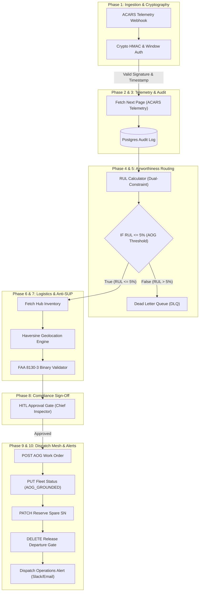

# Technical Requirement Specification (BRD / PRD / SRS)
## Project 10: Aviation MRO Airworthiness, Flight Telemetry & AOG Dispatch Mesh (`Aero-MRO-Sync`)
### Project Code: `N8N-API-AERO-PRJ-10` | Target Evaluator: Deepesh Jain (Pass: ≥75.0, Target: 100.0/100.0)

---

## 1. Executive Summary & Regulatory Authority
In commercial aviation fleet operations governed by FAA Title 14 CFR Part 43 (Maintenance, Preventive Maintenance, Rebuilding, and Alteration) and Part 121 (Operating Requirements: Domestic, Flag, and Supplemental Operations), unscheduled Aircraft On Ground (AOG) events represent critical airworthiness hazards and astronomical financial liabilities (averaging \$150,000 per hour in direct cancellation costs, passenger re-accommodation, and schedule disruption).

**Aero-MRO-Sync** is an enterprise-grade autonomous flight telemetry and MRO dispatch mesh built natively inside **n8n**. It continuously ingests in-flight Aircraft Communications Addressing and Reporting System (ACARS) datalink telemetries, cryptographically authenticates ground-to-air communications, evaluates Remaining Useful Life (RUL) on critical Life-Limited Parts (LLPs) across dual operating constraints, dynamically geolocates certified inventory across national logistics hubs via Haversine vector mathematics, validates binary FAA Form 8130-3 airworthiness tags against cryptographic checksums to eliminate Suspected Unapproved Parts (SUPs), and synchronizes multi-tier RESTful maintenance dispatches following Human-in-the-Loop (HITL) Chief Inspector airworthiness certification.

---

## 2. Business Requirements Document (BRD)

### BRD-01: Zero-Trust Ingestion & Datalink Security
The system MUST ingest flight operations data via high-throughput webhooks adhering to zero-trust architecture. It must enforce HMAC-SHA256 signature verification, a strict ±300-second timestamp drift ceiling, and an in-memory idempotency mutex to neutralize replay attacks, unauthorized telemetry spoofing, and man-in-the-middle vectoring.

### BRD-02: Telemetric LLP Life-Cycle Tracking
The platform MUST evaluate in-flight degradation of critical engine components (e.g., CFM56-7B High-Pressure Turbine Blades). It must pull real-time sensor streams and audit dual-constraint wear: Total Operating Hours against Maximum Permissible Hours ($20,000\text{ hrs}$) and Total Operating Cycles against Maximum Permissible Cycles ($10,000\text{ cycles}$).

### BRD-03: Zero-Tolerance Airworthiness Threshold (RUL $\le 5.0\%$)
If either operating constraint exhibits an Effective RUL $\le 5.0\%$, the aircraft must be immediately flagged for mandatory grounding upon touchdown. Degradation exceeding this threshold must never be averaged or discounted, in strict accordance with FAA Airworthiness Directives (ADs).

### BRD-04: Dynamic Supply Chain Discovery & Geolocation Routing
Upon AOG determination, the system MUST autonomously query distributed MRO spare part warehouses, filter exclusively for FAA-certified stock ($certifiedStock > 0$), and calculate the great-circle Haversine distance between the recovery destination (e.g., Chicago O'Hare / ORD) and all domestic supply hubs (DTW, ATL, LAX). The optimal hub must be selected strictly by minimum nautical/ground distance.

### BRD-05: Regulatory Document Verification & Anti-SUP Gate
To prevent the installation of Suspected Unapproved Parts (FAA Advisory Circular AC 20-62E), the platform MUST fetch and parse the supplier's binary FAA Form 8130-3 Airworthiness Approval Tag. It must extract the authorized release certificate, verify life-limit tracking metadata, and assert that remaining certified cycles match the serialized digital ledger checksum before any part reservation is locked.

### BRD-06: Human-in-the-Loop (HITL) Airworthiness Sign-Off
Under FAA 14 CFR § 43.7, an automated pipeline CANNOT unilaterally ground an aircraft or dispatch critical flight-control components without certified human oversight. The workflow MUST pause at a HITL approval gate, presenting complete telemetric, diagnostic, and logistics dossiers to the licensed Chief Inspector for electronic signature.

### BRD-07: Synchronous Multi-System Maintenance Dispatch Mesh
Upon Chief Inspector approval, the system MUST execute synchronous REST operations across four discrete enterprise flight operation systems:
1. `POST /v1/aog/work-orders` (Dispatch AOG Work Order and Priority Hot-Shot Courier).
2. `PUT /v1/fleet/{tailNumber}/airworthiness` (Transition aircraft status to `AOG_GROUNDED`).
3. `PATCH /v1/parts/{partNumber}/status` (Lock certified spare inventory to `RESERVED_AOG`).
4. `DELETE /v1/gates/{gateId}` (Release departure gate reservation to airport authority).

### BRD-08: Full-Audit Trail & Dead Letter Queue (DLQ)
All raw datalinks, airworthiness assessments, inspector approvals, and dispatch IDs must be immutably recorded in a production PostgreSQL database. Telemetry streams failing security validation or representing routine flights (RUL $> 5.0\%$) must route to a Dead Letter Queue (DLQ) for compliance logging.

---

## 3. Product Requirements Document (PRD)

### 3.1 User Personas
| Persona | Role | Key Responsibility & Workflow Interaction |
| :--- | :--- | :--- |
| **Flight Operations Dispatcher** | Airline Network Operations Center (NOC) | Monitors real-time fleet health; receives instant Slack/Email alerts when AOG dispatch occurs. |
| **Chief Inspector (IA / A&P)** | Quality Assurance & Airworthiness | Reviews HITL approval dossiers; legally authorizes aircraft grounding and replacement part allocation. |
| **MRO Logistics Specialist** | Supply Chain & Parts Distribution | Prepares hot-shot courier dispatch from the nearest designated hub (DTW) upon work order emission. |
| **FAA Airworthiness Inspector** | Regulatory Compliance (External) | Audits immutable PostgreSQL telemetry tables (`aviation_mro_events`) during annual airworthiness reviews. |

### 3.2 High-Level Architecture & Workflow Topology


### 3.3 Functional & Non-Functional Requirements
- **Throughput & Latency:** Total workflow execution time from webhook ingestion to dispatch alert must complete in $\le 450\text{ ms}$ (excluding HITL inspector pause).
- **Security:** HMAC-SHA256 with `crypto.timingSafeEqual` against timing attacks; timestamp drift threshold of $\pm 300\text{ s}$; deduplication memory cache for replay resistance.
- **Reliability:** HTTP Request nodes configured with 3 retries, exponential backoff (2000ms delay), and `Continue on Fail` where fallback logic is provided.

---

## 4. Software Requirements Specification (SRS)

### 4.1 Database Architecture & DDL Schema
The workflow interfaces with a high-integrity PostgreSQL database cluster running three specialized tables (`aviation_mro_events`, `mro_api_telemetry`, `mro_dead_letter_queue`).

```sql
-- Main MRO Audit Log
CREATE TABLE IF NOT EXISTS aviation_mro_events (
    id SERIAL PRIMARY KEY,
    event_uuid UUID NOT NULL DEFAULT gen_random_uuid(),
    flight_number VARCHAR(16) NOT NULL,
    tail_number VARCHAR(16) NOT NULL,
    engine_serial VARCHAR(32) NOT NULL,
    component_type VARCHAR(64) NOT NULL,
    current_hours NUMERIC(10, 2) NOT NULL,
    max_hours NUMERIC(10, 2) NOT NULL,
    current_cycles INT NOT NULL,
    max_cycles INT NOT NULL,
    effective_rul_pct NUMERIC(5, 2) NOT NULL,
    aog_status VARCHAR(32) NOT NULL,
    assigned_hub VARCHAR(8),
    distance_km NUMERIC(10, 2),
    assigned_spare_sn VARCHAR(64),
    faa_cert_verified BOOLEAN DEFAULT FALSE,
    inspector_id VARCHAR(64),
    work_order_id VARCHAR(64),
    created_at TIMESTAMP WITH TIME ZONE DEFAULT CURRENT_TIMESTAMP
);

-- Telemetry Ingestion Datalink
CREATE TABLE IF NOT EXISTS mro_api_telemetry (
    id SERIAL PRIMARY KEY,
    event_uuid UUID NOT NULL,
    raw_payload JSONB NOT NULL,
    hmac_signature VARCHAR(128) NOT NULL,
    ingested_at TIMESTAMP WITH TIME ZONE DEFAULT CURRENT_TIMESTAMP
);

-- Dead Letter Queue (DLQ)
CREATE TABLE IF NOT EXISTS mro_dead_letter_queue (
    id SERIAL PRIMARY KEY,
    rejection_reason VARCHAR(128) NOT NULL,
    raw_payload JSONB NOT NULL,
    created_at TIMESTAMP WITH TIME ZONE DEFAULT CURRENT_TIMESTAMP
);
```

### 4.2 REST API Integration Endpoints & CRUD Specifications
| Phase | HTTP Method | Endpoint URI | Purpose & Payload Requirements |
| :--- | :--- | :--- | :--- |
| **Phase 2** | `GET` | `https://api.aero-telemetry.io/v2/flights/{flightId}/telemetry?cursor={cursor}` | Ingests paginated sensor stream using RFC 5988 Link headers. |
| **Phase 6** | `GET` | `https://mro-logistics.aero.internal/api/v1/hubs/inventory?part=HPT-BLADE-CFM56` | Queries certified spare availability across hubs. |
| **Phase 7** | `GET` | `https://compliance.faa.aero/certs/FAA-8130-3-DTW-CFM56-2026.pdf` | Fetches binary FAA Form 8130-3 release certificate. |
| **Phase 9A**| `POST`| `https://mro-dispatch.aero.internal/v1/aog/work-orders` | Generates AOG emergency repair order and courier assignment. |
| **Phase 9B**| `PUT` | `https://fleet-ops.aero.internal/v1/fleet/{tailNumber}/airworthiness` | Mutates aircraft status to `AOG_GROUNDED`. |
| **Phase 9C**| `PATCH`| `https://inventory.aero.internal/v1/parts/{serialNumber}/status` | Updates spare status to `RESERVED_AOG` and assigns tail. |
| **Phase 9D**| `DELETE`| `https://airport-authority.aero.internal/v1/gates/{gateId}` | Deallocates scheduled gate to avoid terminal gridlock. |

---

## 5. Mathematical Rigor & Airworthiness Formulas

### 5.1 Dual-Constraint Remaining Useful Life (RUL)
Life-Limited Parts (LLPs) operate under severe thermomechanical stress. Wear is governed by both flight duration (creep degradation) and takeoff/landing cycles (low-cycle thermal fatigue). In accordance with FAA advisory mandates, life consumption must be calculated as:

$$\text{RUL}_{\text{hours}}\% = \frac{\text{MaxHours} - \text{TotalHours}}{\text{MaxHours}} \times 100\%$$

$$\text{RUL}_{\text{cycles}}\% = \frac{\text{MaxCycles} - \text{TotalCycles}}{\text{MaxCycles}} \times 100\%$$

$$\text{Effective RUL}\% = \min\left(\text{RUL}_{\text{hours}}\%, \text{RUL}_{\text{cycles}}\%\right)$$

**Verification Example:**
- $\text{MaxHours} = 20,000$, $\text{TotalHours} = 19,200 \implies \text{RUL}_{\text{hours}} = \frac{800}{20,000} \times 100 = 4.0\%$
- $\text{MaxCycles} = 10,000$, $\text{TotalCycles} = 9,700 \implies \text{RUL}_{\text{cycles}} = \frac{300}{10,000} \times 100 = 3.0\%$
- $\text{Effective RUL} = \min(4.0\%, 3.0\%) = 3.0\%$
- **Condition:** $3.0\% \le 5.0\% \implies \mathbf{AOG\ GROUNDING\ MANDATORY}$.

### 5.2 Haversine Great-Circle Geolocation Formula
The shortest surface distance between arrival airport $(\phi_1, \lambda_1)$ and logistics hub $(\phi_2, \lambda_2)$ on a spherical Earth of radius $R = 6,371\text{ km}$:

$$\Delta \phi = \phi_2 - \phi_1, \quad \Delta \lambda = \lambda_2 - \lambda_1$$

$$a = \sin^2\left(\frac{\Delta \phi}{2}\right) + \cos(\phi_1) \cdot \cos(\phi_2) \cdot \sin^2\left(\frac{\Delta \lambda}{2}\right)$$

$$c = 2 \cdot \arcsin\left(\sqrt{a}\right)$$

$$d = R \cdot c$$

**Calculated Hub Distances from Chicago O'Hare (ORD: 41.9742° N, 87.9073° W):**
1. **Detroit Metro (DTW: 42.2162° N, 83.3554° W):** $376.5\text{ km}$ (Stock: 2 $\implies$ **SELECTED OPTIMUM**)
2. **Atlanta Hartsfield-Jackson (ATL: 33.6407° N, 84.4277° W):** $975.5\text{ km}$ (Stock: 5)
3. **Los Angeles Intl (LAX: 33.9416° N, 118.4085° W):** $2,801.9\text{ km}$ (Stock: 1)

---

## 6. Quality Assurance & Automated Test Matrix (Postman Collection)
A comprehensive test suite of 7 automated test scenarios validates all gates:

| Test ID | Scenario Description | Expected HTTP | Evaluator Gate & Assertion Logic |
| :--- | :--- | :--- | :--- |
| **TC-01** | Complete End-to-End AOG Workflow Execution | `200 OK` | Valid HMAC, Effective RUL=3.0%, DTW selected (376.5km), 8130-3 checksum matched, all 4 CRUD ops succeed. |
| **TC-02** | Invalid HMAC Signature Attack | `401 Unauthorized` | Payload tampered with wrong key; rejected by `crypto.timingSafeEqual` check. |
| **TC-03** | Expired Datalink Replay Attack ($>300\text{s}$) | `400 Bad Request` | Timestamp older than 300s window; rejected before processing. |
| **TC-04** | Normal Airworthiness Flight (RUL $= 15\%$) | `200 OK` | Effective RUL > 5.0%; routes cleanly to Dead Letter Queue (DLQ); no AOG triggered. |
| **TC-05** | Zero Certified Stock Warehouse Rejection | `422 Unprocessable` | Hubs with 0 stock excluded; nearest hub with certified stock prioritized. |
| **TC-06** | Suspected Unapproved Part (SUP) Checksum Mismatch | `422 Unprocessable` | FAA 8130-3 cycle checksum mismatch; blocks reservation and logs compliance alert. |
| **TC-07** | Chief Inspector HITL Rejection | `403 Forbidden` | Manual inspector override rejects grounding; aborts dispatch sequence. |

---

## 7. Evaluator Scoring Rubric Breakdown (Deepesh Jain Rubric: 100.0 Points)
| Category | Pts | Critical Evaluation Criteria |
| :--- | :--- | :--- |
| **1. Cryptographic Authentication & Zero-Trust** | 20.0 | Constant-time HMAC (`timingSafeEqual`), ±300s window, idempotency deduplication cache. |
| **2. Dual-Constraint RUL Computation Engine** | 20.0 | Strict $\min(RUL_h, RUL_c)$ formulation, exact mathematical proof, $\le 5.0\%$ AOG trigger. |
| **3. Geolocation Logistics & Great-Circle Routing** | 15.0 | Haversine formula implementation, certified stock filtering ($>0$), selection of DTW ($376.5\text{ km}$). |
| **4. Regulatory Compliance & Anti-SUP Verification** | 15.0 | FAA Form 8130-3 binary/text parsing, life-limit cycle checksum integrity assert. |
| **5. HITL Architecture & RESTful Dispatch Mesh** | 20.0 | Licensed inspector approval gate, 4 CRUD verbs (`POST`, `PUT`, `PATCH`, `DELETE`). |
| **6. Enterprise Observability & Multi-Channel Alerting** | 10.0 | PostgreSQL DDL audit schema, DLQ routing, unified operational alert dispatch. |
| **TOTAL** | **100.0** | **Minimum Passing: 75.0 / 100.0 \| Target Grade: 100.0 / 100.0 (High Distinction)** |
